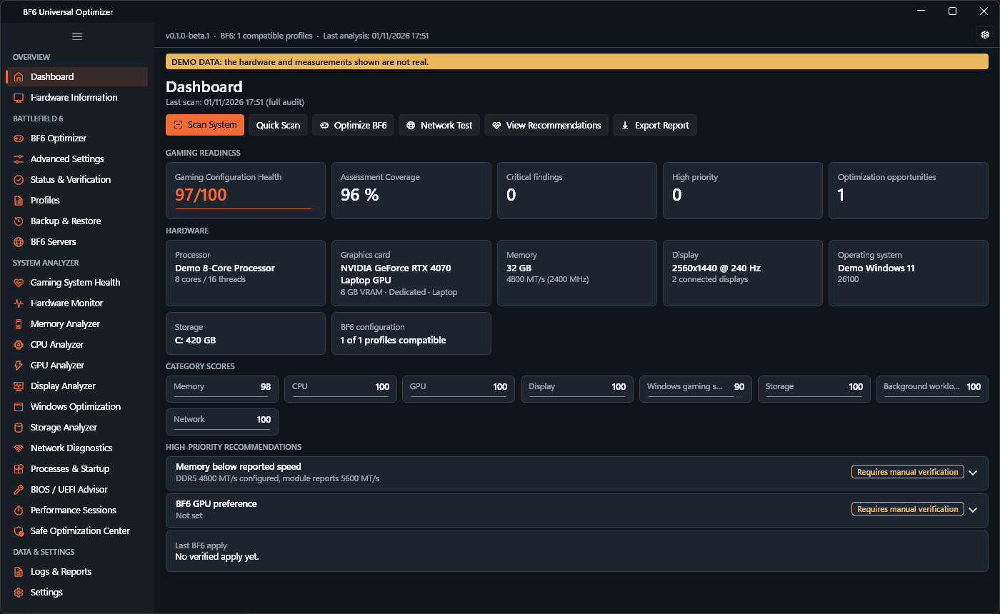
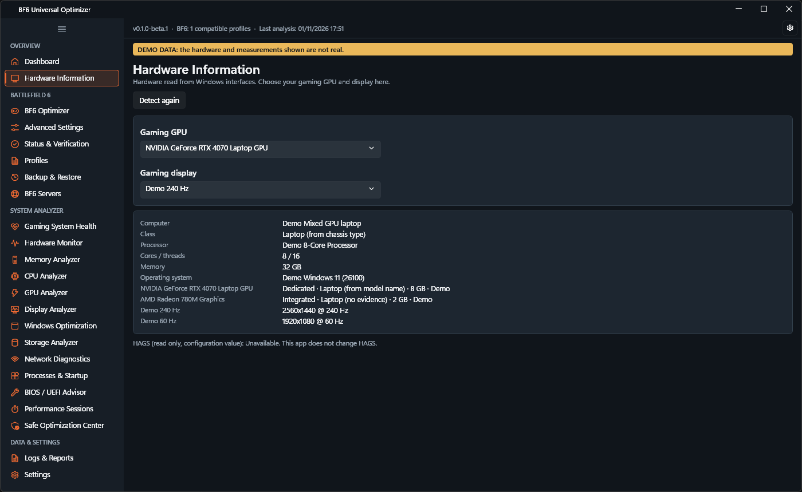
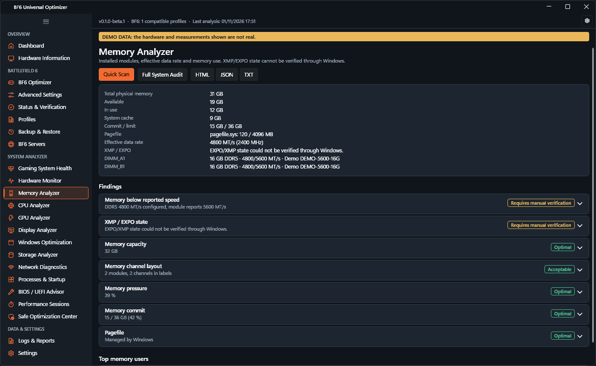
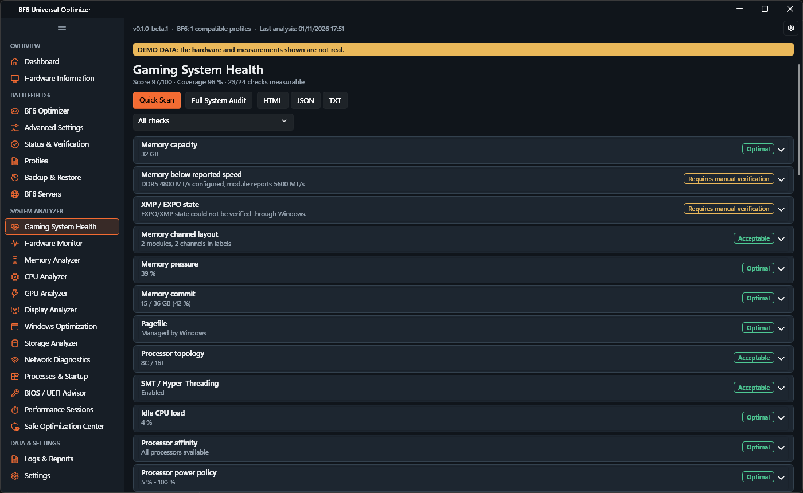
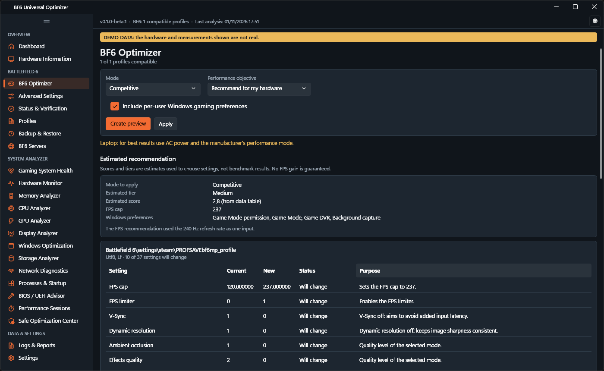
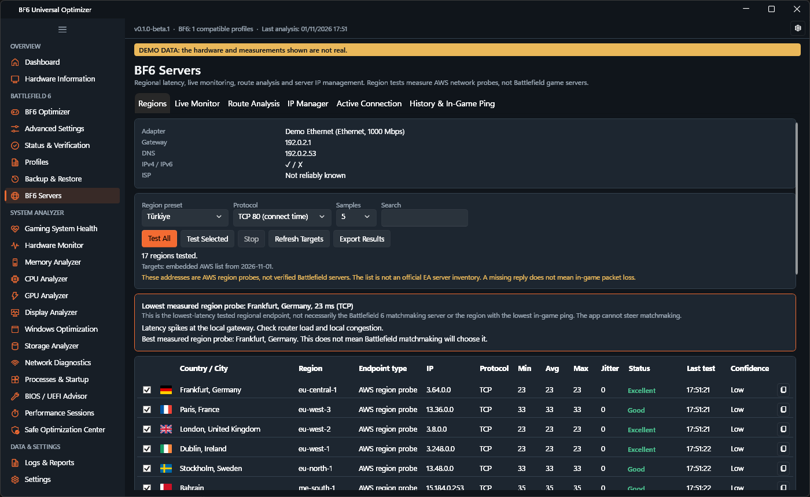
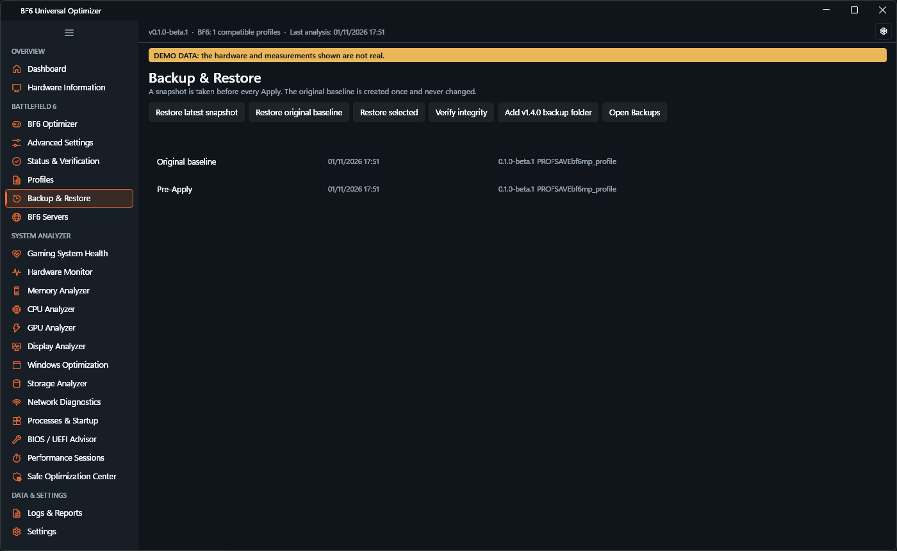

# BF6 Universal Optimizer

Native Windows gaming performance analyzer and Battlefield 6 optimizer with hardware diagnostics, network latency testing, and portable deployment.

[](https://github.com/muratbulat/BF6-Universal-Optimizer/releases)
[](https://github.com/muratbulat/BF6-Universal-Optimizer/actions/workflows/ci.yml)


[Türkçe](README.tr.md)

> **Beta.** This is an early release. Read [Limitations](#limitations) before applying changes.
>
> This is an independent community utility. It is not an official Electronic Arts or Battlefield product and is not endorsed by either.

## Overview

BF6 Universal Optimizer does two related jobs in one portable program:

- **Battlefield 6 optimization:** recommends game settings for your hardware, previews every change, backs up first, verifies the result and rolls back on failure.
- **Windows gaming diagnostics:** audits memory, CPU, GPU, displays, Windows settings, storage and network, and separates verified facts, measurements, inferences and manual checks.

## Features

- Auto, Competitive, Balanced, Quality and Custom optimization modes
- Before/after preview with the purpose of each setting
- Original baseline backup, pre-Apply snapshots and SHA-256 verification
- Gaming configuration health score, shown with its assessment coverage
- Live hardware monitoring and before/during-game performance sessions
- Regional datacenter latency tests, route analysis and a server IP manager
- HTML, JSON and text reports with a privacy review before export
- English and Turkish interface, dark and light themes, responsive layout

## Screenshots

All screenshots show the real application running with clearly labeled demo data.

### Dashboard



### Hardware Diagnostics







### Battlefield Optimization



### Battlefield Server Latency



### Backup & Restore



## Supported Windows versions

Windows 10 and Windows 11, 64-bit. The application has been run on Windows 11 only so far.

## Hardware Compatibility

GPUs are identified through DXGI and Windows interfaces rather than a fixed model list. NVIDIA, AMD and Intel naming is parsed, and models missing from the data file get conservative recommendations. On NVIDIA systems, NVML adds telemetry when the driver provides it. Only an NVIDIA desktop system has been tested on real hardware.

## Battlefield 6 Optimizer

Only settings already present in a compatible profile are changed, and only to values known to be valid. Unknown values are left alone. DLSS, FSR and XeSS selections are never changed. Encoding, line endings and unrelated lines are preserved. Changes stop if the game is running or the file changed since the preview.

## Windows Gaming Diagnostics

Each check reports what was detected, what is expected, its status and confidence, how it was detected, and whether a fix needs a restart or administrator rights. Security features such as Secure Boot and VBS are shown for information and never count against the score. Unknown checks are excluded from the score and lower the coverage figure instead. The score describes configuration health, not expected FPS.

## RAM / XMP / EXPO Analysis

The application shows installed modules and the effective data rate in MT/s. Windows offers no reliable way to read XMP or EXPO state, so it is reported as unverified. A rate below the module's reported speed is flagged for you to check in BIOS/UEFI. It is not treated as proof that a profile is off.

## GPU / CPU / Monitor Analysis

- GPU: identification, dedicated VRAM, driver date and multi-GPU selection
- CPU: topology, including hybrid and multi-CCD layouts, power policy and measured idle load
- Monitor: every display, active refresh rate and the highest rate at the current resolution, flagging a mismatch such as 60 Hz on a 240 Hz panel

Refresh rate changes are guided through Windows settings; the application does not switch modes itself.

## Battlefield Server Latency Tests

Regional tests use public AWS network reachability targets. **These are network probes, not confirmed Battlefield servers**, and the region list is a set of community-reported candidates, not an EA server inventory. The lowest result is not necessarily the region matchmaking will use or your in-game ping, and the application cannot influence matchmaking.

TCP connect time is the default because several regions do not answer ICMP. Results from different protocols are never ranked against each other. A region with no responding target shows "Test endpoint unavailable". Automatic detection of the live game server is unsupported, because Windows does not expose the remote peer of UDP traffic per process.

## Backup and Restore

The first Apply creates an original baseline that is never modified. Every Apply takes a snapshot first. Restores verify SHA-256 hashes before writing, take a safety snapshot, and undo themselves on failure. Backups from the earlier PowerShell package (v1.4.0) can be added and restored.

## Download

Download `BF6Optimizer.exe` from [Releases](https://github.com/muratbulat/BF6-Universal-Optimizer/releases). To verify it:

```powershell
Get-FileHash .\BF6Optimizer.exe -Algorithm SHA256
```

Compare the result with `SHA256SUMS.txt`. The executable is not code-signed, so Windows SmartScreen may warn on first launch.

## Installation / Portable Usage

No installation. Copy `BF6Optimizer.exe` to any folder and run it. You do not need a separately installed .NET Runtime, administrator rights or internet access. No external database server is required, and the application does not use a database.

Data is stored under `%LOCALAPPDATA%\BF6UniversalOptimizer`. An optional portable data mode in Settings keeps it next to the executable.

## Build from Source

Requires the .NET 10 SDK on Windows.

```powershell
dotnet build BF6Optimizer.sln
.\scripts\build-release.ps1
```

The release script tests the code, publishes the self-contained single file, validates the output and writes `Release\BF6Optimizer.exe` with `SHA256SUMS.txt`.

## Testing

```powershell
.\scripts\run-quick-qa.ps1
.\scripts\run-full-qa.ps1
```

The quick script builds and runs unit and integration tests without opening windows. The full script also runs desktop UI automation, launching the application about 45 times on your desktop. Use a VM. Tests use synthetic fixtures and never touch real game files or the real registry. See [docs/ACCEPTANCE.md](docs/ACCEPTANCE.md) for what has and has not been verified.

## Limitations

- Beta software. Apply and restore are tested against fixtures. Run them only after reading the preview.
- Tested on one Windows 11 desktop only. Not yet tested on a clean machine, Windows 10, laptops, AMD or Intel GPUs, multi-monitor setups or display scaling above 100 %.
- BIOS and vendor-specific information such as XMP, EXPO, PBO, Resizable BAR and driver panel settings cannot be read reliably from Windows.
- FPS and frame times are not measured. CPU temperature is not shown, and GPU temperature needs NVML.
- Datacenter latency tests are not Battlefield 6 server ping measurements.
- Writable graphics values are limited to those verified from the earlier package, and a game update can change the profile format.
- Steam Cloud or OneDrive may overwrite changed profiles.

## Roadmap

- Validation on Windows 10, laptops, and AMD and Intel hardware
- Wider writable setting ranges as values are verified
- Testing at higher display scaling and on mixed-DPI monitors

## Contributing

See [CONTRIBUTING.md](CONTRIBUTING.md). Report security problems as described in [SECURITY.md](SECURITY.md).

## License

No open-source license has been applied yet, so all rights are reserved by the author. Third-party components, including WPF-UI and CommunityToolkit.Mvvm, remain under their own licenses.

## Disclaimer

Provided as is, without warranty. Battlefield is a trademark of Electronic Arts Inc. This project is not affiliated with Electronic Arts. No performance gain is promised. Performance depends on your hardware, drivers and the game.
