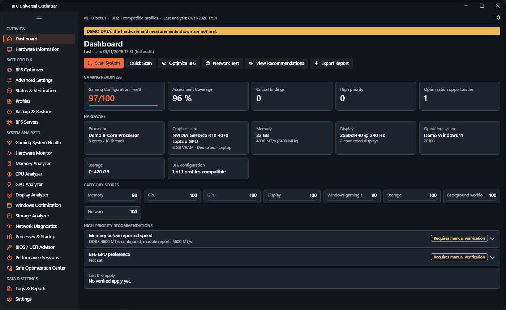
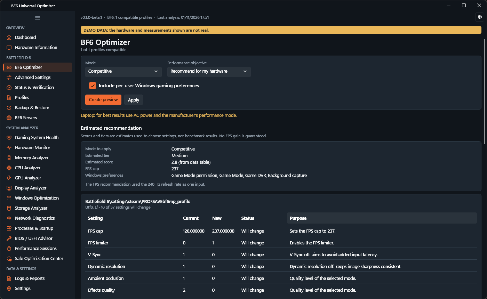
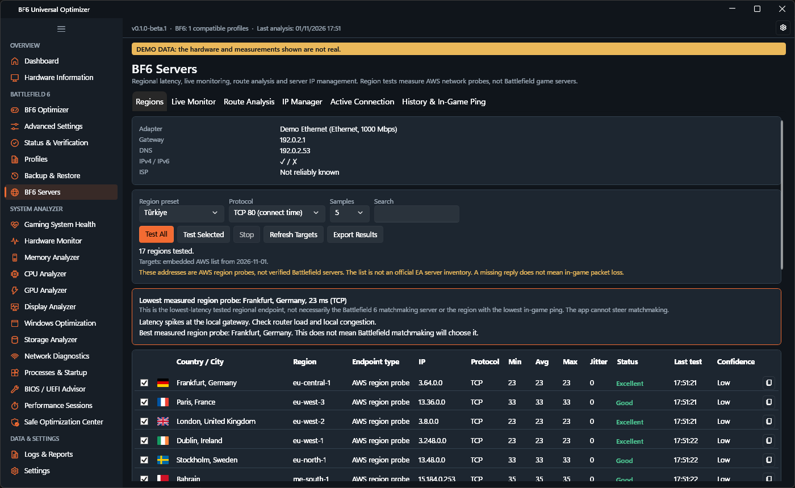

# BF6 Universal Optimizer

Donanım tanılama, ağ gecikme testi ve taşınabilir kullanım sunan yerel Windows oyun performansı analizörü ve Battlefield 6 optimizasyon aracı.

[English](README.md)

> **Beta.** Bu erken bir sürümdür. Değişiklik uygulamadan önce [Sınırlamalar](#sınırlamalar) bölümünü okuyun.
>
> Bu bağımsız bir topluluk aracıdır. Electronic Arts veya Battlefield'ın resmî ürünü değildir ve onlar tarafından desteklenmez.

## Genel bakış

- **Battlefield 6 optimizasyonu:** Donanımınıza göre oyun ayarı önerir, her değişikliği önizler, önce yedek alır, sonucu doğrular ve hata olursa geri alır.
- **Windows oyun tanılaması:** Bellek, CPU, GPU, ekran, Windows ayarları, depolama ve ağı denetler; doğrulanmış bilgi, ölçüm, çıkarım ve elle kontrolü birbirinden ayırır.

## Ekran görüntüleri

Görüntüler gerçek uygulamadan alınmıştır ve açıkça etiketlenmiş demo verisi içerir. Arayüz varsayılan olarak Türkçedir; görüntüler İngilizce dil seçeneğiyle alınmıştır.







## İndirme ve kullanım

[Releases](https://github.com/muratbulat/BF6-Universal-Optimizer/releases) sayfasından `BF6Optimizer.exe` dosyasını indirin, istediğiniz klasöre kopyalayın ve çalıştırın. Kurulum, ayrıca yüklenmiş .NET Runtime, yönetici izni veya internet bağlantısı gerekmez. Harici veritabanı sunucusu gerekmez; uygulama veritabanı kullanmaz.

Dosyayı doğrulamak için:

```powershell
Get-FileHash .\BF6Optimizer.exe -Algorithm SHA256
```

Sonucu `SHA256SUMS.txt` ile karşılaştırın. Dosya kod imzalı değildir; Windows SmartScreen ilk açılışta uyarı verebilir.

Veriler `%LOCALAPPDATA%\BF6UniversalOptimizer` altında tutulur. Ayarlar sayfasındaki isteğe bağlı taşınabilir veri modu verileri EXE'nin yanında saklar.

## Önemli notlar

- **XMP/EXPO:** Windows bu durumu güvenilir biçimde okuyamaz. Etkin veri hızı gösterilir, profil durumu BIOS/UEFI'den doğrulanmalıdır.
- **Sunucu gecikmesi:** Bölge testleri AWS ağ sondalarını ölçer. Bunlar doğrulanmış Battlefield sunucuları değildir; sonuç, oyun içi ping veya eşleştirmenin seçeceği bölge anlamına gelmez.
- **Skor:** Yapılandırma sağlığını gösterir, tahmini FPS değildir. Güvenlik özellikleri skoru düşürmez.
- **Güvenlik sınırları:** Uygulama güvenlik özelliklerini, hizmetleri, sürücüleri veya BIOS'u değiştirmez; oyun dosyalarına veya sürecine müdahale etmez.

## Sınırlamalar

- Beta yazılımdır. Uygulama ve geri yükleme test verileriyle sınanmıştır; önizlemeyi okuyarak kullanın.
- Yalnızca bir Windows 11 masaüstü bilgisayarda çalıştırıldı. Temiz kurulum, Windows 10, dizüstü, AMD/Intel GPU, çoklu monitör ve %100 üzeri ölçekleme henüz test edilmedi.
- FPS ve kare süresi ölçülmez. CPU sıcaklığı gösterilmez.
- Oyun güncellemeleri profil biçimini değiştirebilir. Steam Cloud veya OneDrive değişen profilleri geri yazabilir.

## Kaynaktan derleme

.NET 10 SDK gerekir.

```powershell
dotnet build BF6Optimizer.sln
.\scripts\build-release.ps1
```

## Lisans

Henüz bir açık kaynak lisansı uygulanmadı; tüm hakları yazara aittir. Üçüncü taraf bileşenler kendi lisanslarına tabidir.

## Sorumluluk reddi

Yazılım olduğu gibi, garanti olmaksızın sunulur. Battlefield, Electronic Arts Inc. şirketinin ticari markasıdır. Bu proje Electronic Arts ile bağlantılı değildir. Performans artışı vaat edilmez.
